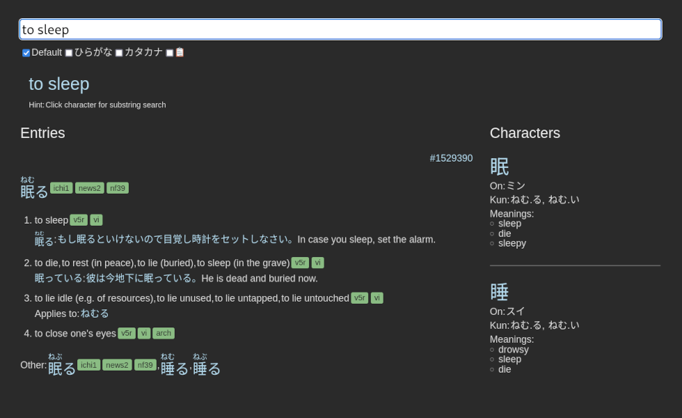
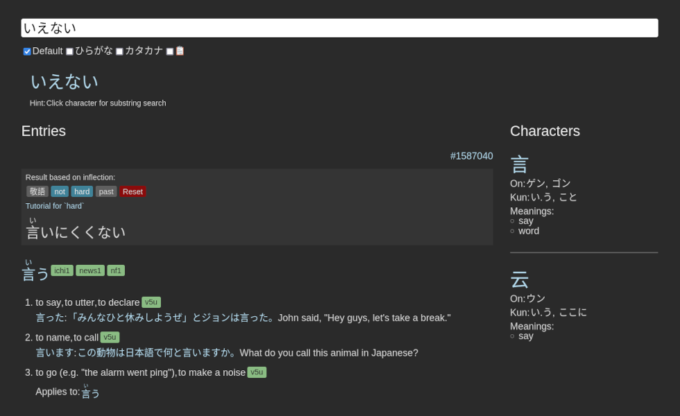
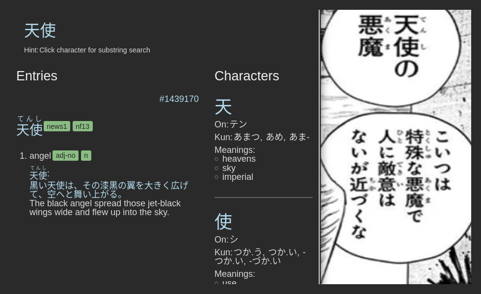
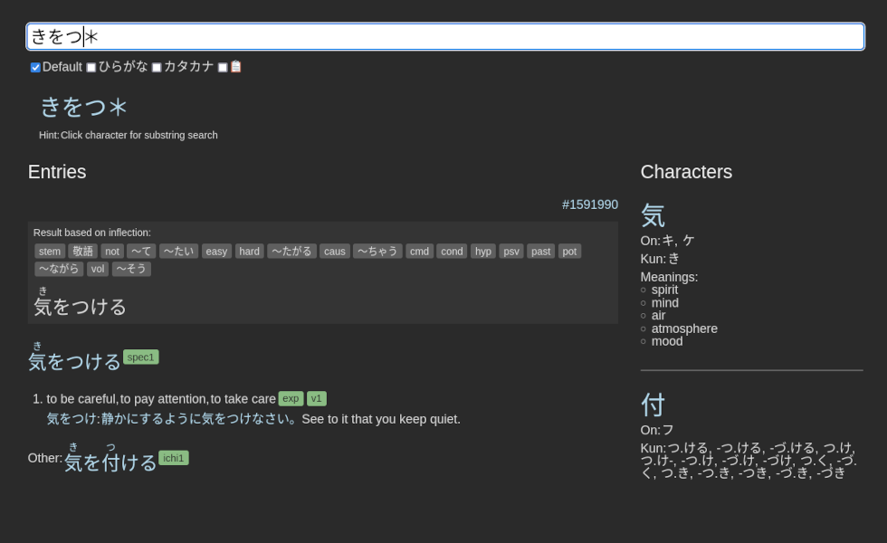
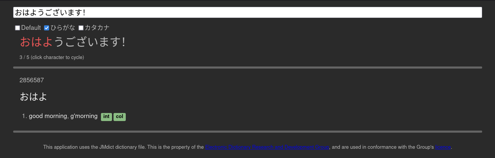
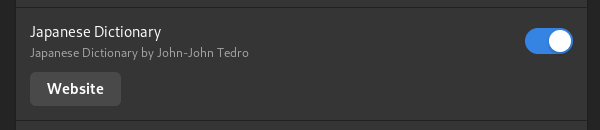
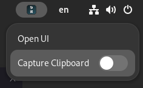
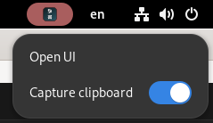
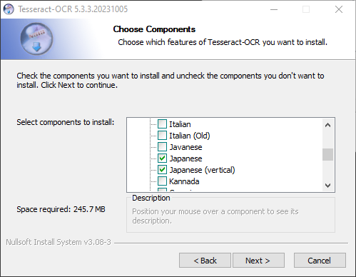
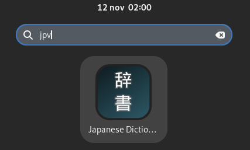

# jpv

[](https://github.com/udoprog/jpv)
[](https://docs.rs/jpv)
[](https://github.com/udoprog/jpv/actions?query=branch%3Amain)
[](https://discord.gg/v5AeNkT)

<a href="https://github.com/udoprog/jpv">

</a>

A fast Japanese dictionary that runs on your own machine. jpv builds a local
database from [JMdict] and [Kanjidic] and serves it through a browser
interface, so lookups work offline and stay private.

* Search in Japanese or English, with wildcards.
* Paste a conjugated word and jpv works out its dictionary form and how it was
  inflected.
* Kanji details: readings, meanings and stroke counts.
* Clipboard capture, including OCR of screenshots through [tesseract], and a
  GNOME extension to feed it.
* Fully offline once the dictionary is built, and quick to start: the database
  is memory mapped.

<table>
<tr>
<td valign="top">
  
  <div style="font-size: 0.8em;">Search Japanese words and phrases, or the English glossary.</div>
</td>
<td valign="top">
  
  <div style="font-size: 0.8em;">Conjugation analysis.</div>
</td>
</tr>
<tr>
<td valign="top">
  
  <div style="font-size: 0.8em;">Image recognition through the clipboard.</div>
</td>
<td valign="top">
  
  <div style="font-size: 0.8em;">Wildcard searching.</div>
</td>
</tr>
</table>

[JMdict]: https://www.edrdg.org/jmdict/j_jmdict.html
[Kanjidic]: https://www.edrdg.org/wiki/index.php/KANJIDIC_Project
[tesseract]: https://github.com/tesseract-ocr/tesseract

<br>

## Install

On Linux (x86_64) and macOS (Apple silicon):

```sh
curl -fsSL https://udoprog.github.io/jpv/install.sh | sh
```

This installs the latest prebuilt `jpv` into `~/.local/bin`. Set
`JPV_INSTALL_DIR` to install elsewhere, or `JPV_VERSION` to a release tag to
pin one. These portable builds leave out OCR for now.

* **Fedora:** the RPM from the [releases] includes OCR, the desktop entry and
  GNOME integration.
* **Windows:** use the MSI from the [releases].

[releases]: https://github.com/udoprog/jpv/releases

<br>

## Getting started

Build the dictionary once. This downloads the dictionary sources and indexes
them:

```sh
jpv build
```

Then start the dictionary service in the background:

```sh
jpv service --background
```



Other commands are listed by `jpv --help`, among them:

* `jpv cli <query>` searches from the command line.
* `jpv send-clipboard --type text/plain <text>` sends text to the running
  service for analysis (requires the `dbus` feature).

Commands that talk to the service use D-Bus activation where available, so
the service is started when needed.

<br>

## GNOME extension

GNOME and Wayland have no general way to capture the clipboard, so jpv ships
a GNOME Shell extension for it. The Fedora RPM installs it; enable it in the
extensions manager:



Then turn on clipboard capture from its panel item:

<table>
<tr>
<td valign="top">
  
  <div style="font-size: 0.8em;">Extension button.</div>
</td>
<td valign="top">
  
  <div style="font-size: 0.8em;">Clipboard capture enabled.</div>
</td>
</tr>
</table>

> **Note:** the icon is red while clipboard capture is on. Only enable it while
> you use it: nothing but your local system stops another application from
> pretending to be the dictionary and reading the clipboard.

Capture is governed by the `capture-clipboard-enabled` setting:

```sh
gsettings get se.tedro.japanese-dictionary.plugins capture-clipboard-enabled
gsettings set se.tedro.japanese-dictionary.plugins capture-clipboard-enabled false
```

<br>

## Features

* `memmap` (default, Unix only) loads the database through memory maps.
* `bundle` embeds the web interface in the binary. Release builds use it.
* `dbus` lets the service talk over D-Bus, for D-Bus activation and the GNOME
  extension.
* `gnome` enables GNOME desktop integration: `dbus`, plus `gio` to open the
  browser.
* `cli` (Windows) builds `jpv` as a console application instead of a GUI one.

OCR through tesseract is linked in by default on Unix and loaded at runtime on
Windows.

<br>

## Building from source

The web interface is built with [trunk] for the `wasm32` target:

```sh
cargo install trunk
rustup target add wasm32-unknown-unknown
```

On Fedora, install the build and OCR dependencies:

```sh
sudo dnf install openssl-devel git gcc tesseract-devel leptonica-devel clang-devel
```

The `gnome` feature also needs `glib2-devel`.

On macOS, install the OCR dependencies with Homebrew. If brew does not link
their pkg-config files, add them to `PKG_CONFIG_PATH`:

```sh
brew install tesseract leptonica
```

On Windows, install tesseract from [UB-Mannheim/tesseract], with "Japanese"
and "Japanese (vertical)" under `Additional language data`:



Then build the interface and run jpv from the project directory, adding
`gnome` on Linux for desktop integration:

```sh
trunk build --release
cargo run --features bundle,gnome
```

Or install it:

```sh
cargo install --path crates/jpv --features bundle,gnome
```

To build and install an RPM for Fedora GNOME, run [tools/fedora-install], or
by hand:

```sh
trunk build --release
cargo build --release -p jpv --features bundle,gnome
cargo generate-rpm -p crates/jpv
sudo dnf install target/generate-rpm/jpv-*.rpm
```

The RPM installs a desktop entry that starts the dictionary service in the
background. Run `jpv build` before first use.



[trunk]: https://trunkrs.dev/
[UB-Mannheim/tesseract]: https://github.com/UB-Mannheim/tesseract/wiki
[tools/fedora-install]: https://github.com/udoprog/jpv/blob/main/tools/fedora-install
